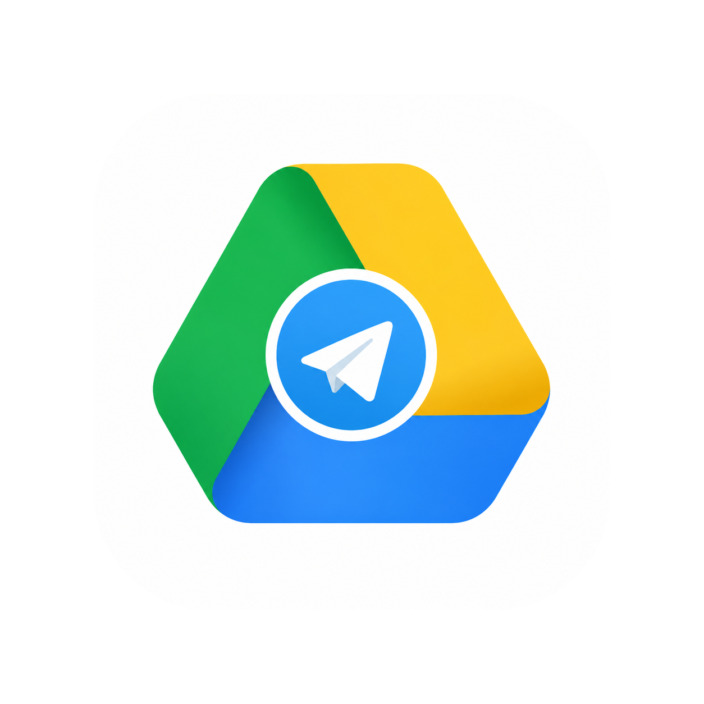

<div align="center">



# TeleDrive

**Unlimited personal cloud storage, powered by your own private Telegram channel.**  
Zero server costs. Zero subscriptions. Direct MTProto encryption straight to Telegram.

[**English**](README.md) • [**Português (Brasil)**](locales/README-pt-BR.md) • [**Español**](locales/README-es.md) • [**繁體中文**](locales/README-zh-TW.md) • [**简体中文**](locales/README-zh-CN.md) • [**हिन्दी**](locales/README-hi.md) • [**Français**](locales/README-fr.md) • [**Bahasa Indonesia**](locales/README-id.md) • [**Русский**](locales/README-ru.md) • [**日本語**](locales/README-ja.md) • [**Deutsch**](locales/README-de.md)

[](https://sourceforge.net/projects/teledrive/files/)
[](https://sourceforge.net/projects/teledrive/files/v0.1.3/)
[](https://www.producthunt.com/products/teledrive-3)
[](https://youtu.be/4AiMn7HSlFg)
[](./LICENSE)
[](https://github.com/senapati484/teledrive/stargazers)
[](https://tauri.app/)
[](https://react.dev/)

<br/>

<a href="https://www.producthunt.com/products/teledrive-3?utm_source=badge-featured&utm_medium=badge&utm_campaign=badge-teledrive-3" target="_blank">
  
</a>

<br/><br/>

[**Website**](https://teledrive.space) • [**Product Hunt 🚀**](https://www.producthunt.com/products/teledrive-3) • [**Downloads**](#-downloads) • [**Beta Testing Poll 🧪**](https://github.com/senapati484/teledrive/discussions/35) • [**Video Demo**](#-video-walkthrough--demo) • [**Report a Bug**](https://github.com/senapati484/teledrive/issues/new/choose) • [**Request a Feature**](https://github.com/senapati484/teledrive/issues/new/choose)

</div>

---

## 🎬 Video Walkthrough & Demo

<div align="center">

<a href="https://youtu.be/4AiMn7HSlFg" target="_blank">
  
</a>

<br/>

**[▶️ Watch on YouTube: "I Turned Telegram Into Unlimited Cloud Storage"](https://youtu.be/4AiMn7HSlFg)**  
*Full video walkthrough demonstrating direct MTProto file streaming, multi-page PDF viewing, CSV inspection, CodeMirror 6 code editor, and automated directory backups.*

</div>

---

## 💡 Why TeleDrive?

Telegram offers virtually unlimited cloud storage in private channels, but lacks a folder hierarchy, virtual catalog, and drive-style desktop workflow. **TeleDrive** bridges that gap:

- **Zero Relay Backend**: All file operations and MTProto connections happen directly from your local machine to Telegram data centers.
- **Virtual Drive**: Nested directories, search, starred files, archive, and trash are indexed in a pinned catalog inside your channel.
- **Hardware-Encrypted Vault**: Credentials and session keys are locked in Tauri Stronghold using Argon2id-derived keys.
- **Multi-Account**: Switch between multiple phone numbers with complete session and local vault isolation.

---

## 📥 Downloads

Latest release: **v0.1.3** · Pre-compiled native binaries across 5 platforms:

| OS | Package Format | Direct Download | Architecture / Compatibility | Size |
|:---|:---|:---|:---|---:|
| **Windows** | Setup Installer (`.exe`) | [**teledrive-setup.exe**](https://sourceforge.net/projects/teledrive/files/v0.1.3/teledrive-setup.exe/download) | x64 64-Bit (Windows 10 / 11) | 5.8 MB |
| **Windows** | MSI Package (`.msi`) | [**teledrive.msi**](https://sourceforge.net/projects/teledrive/files/v0.1.3/teledrive.msi/download) | Enterprise Installer (Win 10 / 11) | 7.3 MB |
| **macOS** | Universal Disk Image (`.dmg`) | [**teledrive.dmg**](https://sourceforge.net/projects/teledrive/files/v0.1.3/teledrive.dmg/download) | Apple Silicon (M1–M4) & Intel x64 | 14.4 MB |
| **Linux** | Universal AppImage (`.AppImage`) | [**teledrive.AppImage**](https://sourceforge.net/projects/teledrive/files/v0.1.3/teledrive.AppImage/download) | Standalone Portable (glibc 2.31+) | 85.5 MB |
| **Linux** | Debian / Ubuntu (`.deb`) | [**teledrive.deb**](https://sourceforge.net/projects/teledrive/files/v0.1.3/teledrive.deb/download) | x86_64 / amd64 | 7.5 MB |
| **Linux** | Fedora / RHEL (`.rpm`) | [**teledrive.rpm**](https://sourceforge.net/projects/teledrive/files/v0.1.3/teledrive.rpm/download) | x86_64 / amd64 | 7.5 MB |
| **Android** | Universal APK (`.apk`) | [**teledrive.apk**](https://sourceforge.net/projects/teledrive/files/v0.1.3/teledrive.apk/download) | Android 8.0+ (ARM64, ARMv7a, x86_64) | 45.9 MB |
| **iOS** | Sideload Package (`.ipa`) | [**teledrive.ipa**](https://sourceforge.net/projects/teledrive/files/v0.1.3/teledrive.ipa/download) | iOS 15.0+ (AltStore / TrollStore) | 24.1 MB |
| **iOS** | Simulator Build (`.zip`) | [**teledrive-ios-simulator.zip**](https://sourceforge.net/projects/teledrive/files/v0.1.3/teledrive-ios-simulator.zip/download) | iOS Simulator (x86_64 / arm64) | 24.1 MB |

> 🌐 Full package catalog, mirror links, and cryptographic checksums are available on [**SourceForge**](https://sourceforge.net/projects/teledrive/files/) or [**teledrive.space**](https://teledrive.space).

<details>
<summary>🔐 <b>Verify SHA-256 Cryptographic Checksums (v0.1.3)</b></summary>

```
dfb353e361336ebbb8921982aa190b1a4e765f987d6558535582d837e2c3b633  teledrive.dmg
3cfe950e5d64d80c8733586198bd6136fdfc19c3dcde0ee516b5e08eb7ba9491  teledrive-setup.exe
fc433cf302a739b8a39a0ac95f85a86e6c2c9ad9e3fc11ae1eae89a49d52cbe3  teledrive.msi
a13e910d62262038bca5203ca652636c738f78f55f25210d60a01c6aadee02dd  teledrive.AppImage
fec9e1596ec35d49bebdbbae4579f2abdacb13bdde73156109cf3a4ac57286d2  teledrive.deb
11ce69e7001fe62c8547f5b74f4237bfd3b57b49f723e5d9ad9a58e3200a7fe1  teledrive.rpm
8368b7899484ccf820607df315071e86546c5c94c0534b7d1bf2eb081437cda8  teledrive.apk
1ee38b2ae8900fdb5a9dbe7d2aded8ad04f719a048400453b02f009cd305c779  teledrive.ipa
05797dcca05decc6ae463a560535ddd6cd013cd941b100e15e89351de6472745  teledrive-ios-simulator.zip
```

Verify binary integrity in terminal:
```bash
shasum -a 256 <filename>
```
</details>

---

## ✨ Features

- **Unlimited Cloud**: Uses your private Telegram channel as the backing store with 0 recurring fees.
- **Native Cross-Platform**: Ultra-lightweight binaries across 5 platforms (macOS, Windows, Linux, Android, and iOS) built on Tauri v2 & Rust.
- **11 Localized Languages**: Full native UI support for English, Portuguese, Spanish, Traditional Chinese, Simplified Chinese, Hindi, French, Indonesian, Russian, Japanese, and German.
- **Direct MTProto Streaming**: GramJS engine streams 512 KB chunks directly with up to 4 concurrent upload threads.
- **Privacy-First**: No TeleDrive tracking, telemetry, or middleman servers. Your files stay between you and Telegram.
- **Instant Search & Organization**: Breadcrumbs, file type filters, grid/list view, and keyboard navigation.

---

## ⚙️ How It Works

```
┌─────────────────────────────────────────────────────────────────┐
│                       React 19 Frontend                         │
│   ┌─────────────────────┐             ┌─────────────────────┐   │
│   │    Zustand State    │             │ GramJS Client Engine│   │
│   └──────────┬──────────┘             └──────────┬──────────┘   │
└──────────────┼───────────────────────────────────┼──────────────┘
               │                                   │
          Tauri IPC                           Direct MTProto
        (Bridge Calls)                       (Secure SSL/TLS)
               │                                   │
┌──────────────▼──────────┐              ┌─────────▼──────────────┐
│     Tauri Rust Core     │              │   Telegram Cloud API   │
│  ┌───────────────────┐  │              │  (Private Channel)     │
│  │ Stronghold Vault  │  │              └────────────────────────┘
│  └───────────────────┘  │
└─────────────────────────┘
```

1. **Direct Connection**: Authenticates directly with Telegram's MTProto servers over TLS port 443.
2. **Chunked Media Upload**: Slices large files into 512 KB fragments streamed concurrently.
3. **Pinned Catalog Index**: Maintains an encrypted JSON descriptor catalog pinned to your private channel for directory navigation across devices.

---

## 🧪 Beta Testers Wanted!

We are looking for beta testers to help test upcoming releases, performance enhancements, and new features:

> 🗳️ **Community Poll:**  
> **👉 [Want to beta test the next version of TeleDrive? 🧪](https://github.com/senapati484/teledrive/discussions/35)**  
> Vote in our community poll, share your feedback, and get early access to pre-release builds!

---

## 🚀 Getting Started

### 🛠️ Quick Start for Contributors & Developers

TeleDrive is 100% open-source and easy to set up locally. It comes with built-in development credentials, so you can start contributing in under 2 minutes without creating a custom Telegram developer app.

#### 1. Clone the Repository
```bash
git clone https://github.com/senapati484/teledrive.git
cd teledrive
```

#### 2. Install Dependencies
```bash
npm install
```
> ℹ️ *The `postinstall` hook automatically applies GramJS MTProto compatibility patches (`scripts/patch-telegram.cjs`) required for Tauri and browser runtimes.*

#### 3. Start the Development Server
```bash
# Run the cross-platform desktop application with Tauri v2 hot-reloading:
npm run tauri dev

# Or run the browser web client preview:
npm run dev
```

---

### 📋 Prerequisites

Ensure your development environment meets these baseline requirements before running locally:

| Requirement | Supported Version | Notes |
|:---|:---|:---|
| **Node.js** | `>= 18.0.0` (`v20+` LTS recommended) | JavaScript/TypeScript runtime & package tooling |
| **Rust** | Latest stable (`rustup default stable`) | Required to compile the native Tauri backend core |
| **System Toolchain** | Platform specific (see below) | C/C++ compiler and webview runtime libraries |

#### Platform-Specific Build Dependencies
- **macOS**:
  ```bash
  xcode-select --install
  ```
- **Linux (Ubuntu / Debian)**:
  ```bash
  sudo apt update && sudo apt install -y build-essential libwebkit2gtk-4.1-dev libappindicator3-dev librsvg2-dev patchelf
  ```
- **Linux (Fedora / RHEL)**:
  ```bash
  sudo dnf install -y webkit2gtk4.1-devel openssl-devel libappindicator-gtk3-devel librsvg2-devel
  ```
- **Windows**:
  - [Visual Studio C++ Build Tools](https://visualstudio.microsoft.com/visual-cpp-build-tools/) (select "Desktop development with C++").
  - [WebView2 Runtime](https://developer.microsoft.com/en-us/microsoft-edge/webview2/) (pre-installed on Windows 10/11).

---

### 🧪 Verifying & Testing

Before submitting a pull request, run local verification checks:

```bash
# Run Vitest test suite
npm test

# Verify TypeScript types and Vite bundle
npm run build

# Verify Rust backend compilation
cargo check --manifest-path src-tauri/Cargo.toml
```

---

### 🔑 Telegram API Credentials (Optional)

TeleDrive includes built-in development credentials so you can log in immediately. If you wish to test with your own Telegram Application ID and Hash:

1. Sign in to [**my.telegram.org**](https://my.telegram.org) with your phone number.
2. Navigate to **API development tools** and create an application (e.g., `TeleDrive-Dev`).
3. Copy your `api_id` and `api_hash`.
4. Provide them either directly inside the app under **Settings → API Configuration**, or create a `.env` file in the root directory:
   ```env
   VITE_TELEGRAM_API_ID=your_api_id
   VITE_TELEGRAM_API_HASH=your_api_hash
   ```

---

### 📦 End-User Pre-compiled Installers

If you are an end user looking to use TeleDrive without compiling from source, download the latest official installers for macOS, Windows, Linux, Android, or iOS directly from the [**Downloads table**](#-downloads) above or [**teledrive.space**](https://teledrive.space).

For pull request conventions, branch naming, and architectural guidelines, please review our [**Contributing Guide (CONTRIBUTING.md)**](CONTRIBUTING.md).

---

## ⌨️ Keyboard Shortcuts

| Shortcut | Action |
|:---|:---|
| `/` or `⌘ F` | Focus search bar |
| `⌘ A` | Select all items in folder |
| `⌘ D` | Download selected items |
| `F2` | Rename selected item |
| `Backspace` / `Del` | Move selected item to Trash |
| `Esc` | Clear selection / blur search |
| `?` | Open keyboard cheat sheet |

---

## 🤝 Contributing

We welcome issues, feedback, ideas, and pull requests!

- 🧪 **Beta Testing**: [Want to beta test the next version of TeleDrive? 🧪](https://github.com/senapati484/teledrive/discussions/35) — Vote in the community poll!
- 💬 **Discussions**: Join our [GitHub Discussions](https://github.com/senapati484/teledrive/discussions) to ask questions or suggest ideas.
- 🛠️ **Development Guide**: Read [**CONTRIBUTING.md**](CONTRIBUTING.md) for local environment setup, architecture notes, and PR guidelines.
- 🐛 **Report Issues**: Use our structured [Issue Forms](https://github.com/senapati484/teledrive/issues/new/choose).

---

## 📜 License

TeleDrive is open-source software licensed under the [GNU GPL-3.0 License](./LICENSE).

*Disclaimer: TeleDrive is an independent open-source project and is not affiliated with, sponsored by, or endorsed by Telegram FZ-LLC. Storing large volumes of files is subject to Telegram's Terms of Service and API fair-use policies.*

---

<div align="center">

Created with ❤️ by **[Senapati484](https://github.com/senapati484)**

If you like TeleDrive, give it a ⭐ on [GitHub](https://github.com/senapati484/teledrive)!

</div>
