<div align="center">


# TeleDrive

**Unlimited personal cloud storage, powered by your own private Telegram channel.**
No servers. No subscriptions. Your files go straight from your device to Telegram.

[](https://sourceforge.net/projects/teledrive/files/)
[](https://sourceforge.net/projects/teledrive/files/v0.1.1/)
[](./LICENSE)

[](https://tauri.app/)
[](https://react.dev/)
[](https://tailwindcss.com/)
[](https://github.com/senapati484/teledrive/stargazers)
[](https://github.com/senapati484/teledrive/issues)
[](#-contributing)

[**Website**](https://www.teledrive.space) · [**Download**](#-download) · [**Report a bug**](https://github.com/senapati484/teledrive/issues/new) · [**Request a feature**](https://github.com/senapati484/teledrive/issues/new)

</div>

---

## 📥 Download

Latest version: **v0.1.1**. Pick your platform:

<div align="center">

[-0078D6?style=for-the-badge&logo=windows&logoColor=white)](https://sourceforge.net/projects/teledrive/files/v0.1.1/teledrive-setup.exe/download)
[](https://sourceforge.net/projects/teledrive/files/v0.1.1/teledrive.msi/download)

[](https://sourceforge.net/projects/teledrive/files/v0.1.1/teledrive.dmg/download)

[](https://sourceforge.net/projects/teledrive/files/v0.1.1/teledrive.AppImage/download)
[](https://sourceforge.net/projects/teledrive/files/v0.1.1/teledrive.deb/download)
[](https://sourceforge.net/projects/teledrive/files/v0.1.1/teledrive.rpm/download)

[](https://sourceforge.net/projects/teledrive/files/)

</div>

| Platform | File | Size |
|:---|:---|---:|
| Windows | `teledrive-setup.exe` (recommended), `teledrive.msi` | 5.5 MB / 7.2 MB |
| macOS | `teledrive.dmg` | 15.8 MB |
| Linux | `teledrive.AppImage`, `teledrive.deb`, `teledrive.rpm` | 86.1 MB / 8.4 MB / 8.0 MB |
| Android | Build from source (see [Getting Started](#-getting-started)) | — |

> **Heads-up:** release binaries may not be code-signed yet. If Windows SmartScreen or macOS Gatekeeper warns you, that is expected for unsigned open-source builds. You can always [build from source](#-getting-started) and inspect every line of code yourself.

---

## 📊 Download Stats

Counts are collected from SourceForge **from 2026-06-21 to today** and refreshed automatically every day by a [GitHub Action](./.github/workflows/update-stats.yml).

<div align="center">

| Since launch (2026-06-21) | This week | This month |
|:---:|:---:|:---:|
|  |  |  |

</div>

---

## 🗺️ Table of Contents

- [Why TeleDrive?](#-why-teledrive)
- [Features](#-features)
- [How It Works](#️-how-it-works)
- [Security Model](#-security-model)
- [Virtual File Catalog Schema](#-virtual-file-catalog-schema)
- [Getting Started](#-getting-started)
- [Keyboard Shortcuts & Gestures](#️-keyboard-shortcuts--gestures)
- [Roadmap](#-roadmap)
- [Contributing](#-contributing)
- [License & Disclaimer](#-license--disclaimer)

---

## 💡 Why TeleDrive?

Telegram lets you store large files in channels for free. TeleDrive turns that into a proper drive: nested folders, search, stars, archive, trash, and multi-account support, with a Google Drive-style interface. Everything runs on your device and talks directly to Telegram over MTProto. There is no TeleDrive backend to trust, pay for, or shut down.

---

## 🌟 Features

- **Unlimited, zero-cost storage**: uses a private channel of your own as the backing store.
- **Cross-platform native apps**: lightweight binaries for macOS, Windows, Linux, and Android, built with Tauri v2.
- **Multi-account session isolation**: separate local vaults and folder catalogs per phone number. Log out and switch accounts without data leakage.
- **Direct client-side MTProto**: GramJS connects your device straight to Telegram. No proxies, middleware, or third-party servers.
- **Encrypted local credential vault**: `api_id`, `api_hash`, and session tokens live in Tauri Stronghold (Argon2id-derived keys).
- **Virtual folders**: folders, subfolders, stars, archive, and trash are simulated with a metadata catalog pinned in your channel.
- **Keyboard-first on desktop, gesture-friendly on mobile**: see [shortcuts](#️-keyboard-shortcuts--gestures).

---

## ⚙️ How It Works

TeleDrive is a decentralized, offline-first client.

```
┌────────────────────────────────────────────────────────┐
│                   React 19 Webview                     │
│  ┌──────────────────────┐    ┌──────────────────────┐  │
│  │   Zustand Stores     │    │ GramJS Client Engine │  │
│  └──────────┬───────────┘    └──────────┬───────────┘  │
└─────────────┼───────────────────────────┼──────────────┘
              │                           │
         Tauri IPC                   Direct MTProto
       (Bridge Calls)               (Secure SSL/TLS)
              │                           │
┌─────────────▼───────────┐         ┌─────▼──────────────┐
│     Tauri Rust Core     │         │ Telegram Cloud API │
│  ┌───────────────────┐  │         │   (DC Gateways)    │
│  │ Stronghold Vault  │  │         └────────────────────┘
│  └───────────────────┘  │
└─────────────────────────┘
```

### Startup & sync sequence

```mermaid
sequenceDiagram
    autonumber
    actor User
    participant Frontend as React Webview (GramJS)
    participant Core as Tauri Rust Core
    participant Vault as Stronghold Secure Store
    participant TG as Telegram Cloud Gateway

    User->>Frontend: Launch TeleDrive
    Frontend->>Core: Request stored session (IPC: load_session)
    Core->>Vault: Fetch Argon2id-encrypted credentials
    Vault-->>Core: Decrypted api_id, api_hash & GramJS Session
    Core-->>Frontend: Return credentials & session token

    rect rgb(30, 41, 59)
        note right of Frontend: Bootstrapping direct connection
        Frontend->>TG: Connect via MTProto socket (port 443)
        TG-->>Frontend: Auth connection validated
    end

    Frontend->>TG: Search channel for pinned catalog ("teledrive_index")
    TG-->>Frontend: Return pinned JSON catalog (TeleFile[])
    Frontend->>Frontend: Parse catalog & mount virtual folder tree
    Frontend-->>User: Render file browser
```



### Uploads

1. Large files are split into **512 KB** parts.
2. GramJS uploads parts sequentially or concurrently (up to 4 streams) via `UploadPartRequest`.
3. A `SendMediaRequest` attaches the uploaded parts to a message in your private channel.
4. A `TeleFile` descriptor (`messageId`, `channelId`, `name`, `size`, `folderPath`) is appended to the catalog.
5. The updated catalog is serialized, uploaded, and pinned as the new index message.

---

## 🔒 Security Model

- **No TeleDrive servers.** File content and metadata never pass through machines run by the TeleDrive developers.
- **Stronghold vault.** Credentials and MTProto auth keys are stored in Tauri Stronghold, protected by Argon2id-derived keys bound to your system profile.
- **Clean logout.** Logging out wipes that account's vault entry and clears the session from memory.
- **Your channel, your data.** Files are as private as your Telegram channel. Keep it private and keep your Telegram account secured with two-step verification.

Found a vulnerability? Please open a private security advisory on GitHub (**Security → Report a vulnerability**) rather than a public issue.

---

## 📂 Virtual File Catalog Schema

The folder tree is a JSON array of `TeleFile` descriptors pinned in your channel:

```json
[
  {
    "id": "c1a23b45-6789-01cd-ef23-456789abcdef",
    "name": "annual_budget_2026.xlsx",
    "size": 2457600,
    "mime": "application/vnd.openxmlformats-officedocument.spreadsheetml.sheet",
    "folderPath": "/Documents/Finances",
    "messageId": 1045,
    "channelId": "-1001928374650",
    "uploadedAt": 1782355200000,
    "starred": true,
    "trashed": false,
    "archived": false
  }
]
```

---

## 🚀 Getting Started

### 1. Get Telegram API keys

1. Go to [my.telegram.org](https://my.telegram.org/) and sign in with your phone number.
2. Open **API development tools** and create an application (e.g. `MyTeleDrive`).
3. Copy the `api_id` and `api_hash`.
4. Enter them on TeleDrive's setup screen. They are stored in your local encrypted vault.

### 2. Run from source

**Prerequisites**

- **Rust & Cargo** 1.78+ ([rustup.rs](https://rustup.rs/))
- **Node.js** 20.19+ or 22.12+
- **macOS:** Xcode command-line tools
- **Windows:** Visual Studio Build Tools with the "Desktop development with C++" workload
- **Android (optional):** Android SDK & NDK

```bash
git clone https://github.com/senapati484/teledrive.git
cd teledrive
npm install

npm run tauri dev            # desktop
npm run tauri android dev    # Android (emulator running)
```

### 3. Build for production

```bash
npm run tauri build          # installers for your current OS
npm run tauri android build  # Android .apk
```

Output locations: `src-tauri/target/release/bundle/` (`dmg/`, `msi/`, `deb/`, and so on).

### Troubleshooting

- **Node version warning:** Vite and Tauri v2 need Node 20.19+ or 22.12+. Run `nvm install 22`.
- **Stronghold build failure:** update your C++ toolchain. On Windows, confirm the "Desktop development with C++" workload is installed.
- **Connection timeouts:** Telegram rate-limits connections. The client retries with exponential backoff, so check your network and wait a moment.

---

## ⌨️ Keyboard Shortcuts & Gestures

### Desktop

| Keys | Action |
|:---|:---|
| `/` or `⌘ F` | Focus search |
| `Esc` | Clear selection / blur search |
| `g g` / `g l` | Scroll to top / bottom |
| `⌘ A` | Select all in current folder |
| `F2` | Rename selected item |
| `⌘ D` | Download selected items |
| `Backspace` / `Del` | Move to Trash (permanent delete if already in Trash) |
| `?` | Show shortcut cheat sheet |

### Mobile (Android)

- **Pull to refresh** to resync the index.
- **Long-press** a file or folder for the action sheet.
- **Back gesture** closes sheets, drawers, and dialogs one at a time before leaving the app.

---

## 🧭 Roadmap

- [x] Cross-platform desktop builds (Windows, macOS, Linux)
- [x] Multi-account isolation
- [x] Virtual folders, stars, archive, trash
- [ ] Published Android release
- [ ] Code-signed Windows and macOS builds
- [ ] Optional client-side file encryption before upload
- [ ] File sharing links and previews

Have an idea? [Open an issue](https://github.com/senapati484/teledrive/issues/new).

---

## 🤝 Contributing

Contributions of all sizes are welcome: bug reports, docs, translations, and code.

1. **Fork** the repo and create a branch: `feature/…`, `bugfix/…`, or `docs/…`.
2. **Format and lint** before committing: `npm run lint` and `cargo fmt`.
3. **Write semantic commits**, e.g. `feat(ui): center three-dot action button`.
4. **Open a pull request** against `main`, describe the change, and attach screenshots for any UI work.

New here? Look for issues labeled `good first issue`.

---

## 📜 License & Disclaimer

TeleDrive is free software released under the [GNU GPL-3.0](./LICENSE) license.

*TeleDrive is a community-driven open-source project and is not affiliated with, sponsored by, or endorsed by Telegram FZ-LLC. Storing large volumes of data on Telegram may be subject to bandwidth limits, account restrictions, and Telegram's Terms of Service. Use responsibly.*

<div align="center">

If TeleDrive is useful to you, consider giving it a ⭐ on [GitHub](https://github.com/senapati484/teledrive).

</div>
