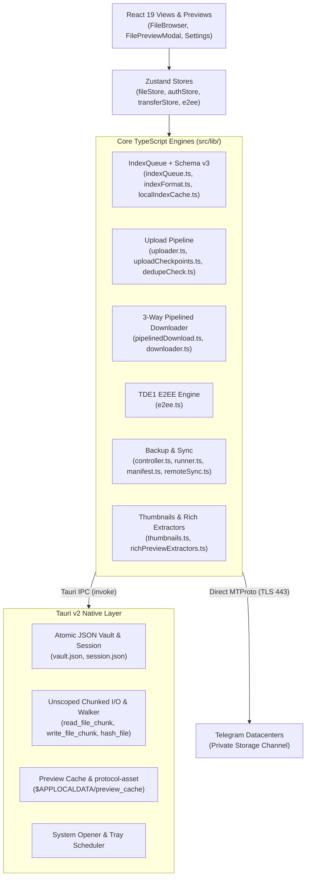
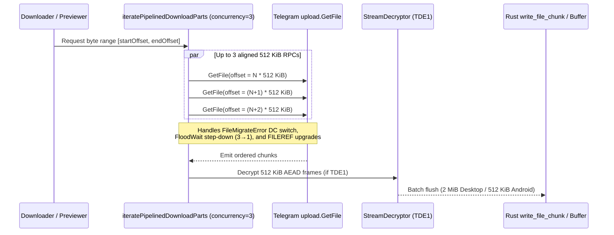

# TeleDrive System Architecture & Technical Reference

TeleDrive is a local-first, cross-platform cloud drive built with **Tauri v2**, **Rust**, **React 19**, **TypeScript**, and **GramJS (MTProto)**. Every connection goes directly from the user's device to Telegram's datacenters—with no intermediate relay backend, telemetry server, or recurring storage fee.

---

## Table of Contents

1. [Executive Summary](#1-executive-summary)
2. [Architecture Overview](#2-architecture-overview)
3. [Design Decisions & Rationale](#3-design-decisions--rationale)
4. [Core Subsystems & Data Flows](#4-core-subsystems--data-flows)
   - [4.1 Auth, Vault & Multi-Account Isolation](#41-auth-vault--multi-account-isolation)
   - [4.2 Virtual Catalog, Schema v3 & IndexQueue](#42-virtual-catalog-schema-v3--indexqueue)
   - [4.3 Upload Pipeline: Checkpoints, Dedupe & Multi-Segment Splitting](#43-upload-pipeline-checkpoints-dedupe--multi-segment-splitting)
   - [4.4 Pipelined Downloads & Range Seeking](#44-pipelined-downloads--range-seeking)
   - [4.5 Security & `TDE1` Client-Side Encryption](#45-security--tde1-client-side-encryption)
   - [4.6 Automated Folder Backups & Multi-Device Sync](#46-automated-folder-backups--multi-device-sync)
   - [4.7 Grid Thumbnails & Universal In-App Previews](#47-grid-thumbnails--universal-in-app-previews)
5. [Native Rust Command Reference (`src-tauri`)](#5-native-rust-command-reference-src-tauri)
6. [Performance Characteristics & Mitigations](#6-performance-characteristics--mitigations)
7. [Internationalization & Build Verification](#7-internationalization--build-verification)

---

## 1. Executive Summary

Telegram private channels provide high-capacity cloud object storage over MTProto, but lack hierarchical directories, virtual search, deduplication, client-side encryption, and rich document previews. TeleDrive turns a private `TeleDrive Storage` channel into a deterministic drive:

| Concern | Implementation Strategy |
| :--- | :--- |
| **Network Transport** | Direct TLS MTProto via GramJS (`src/lib/telegram/client.ts`) — zero custom backend |
| **Directory Metadata** | Gzipped Schema v3 JSON chunks pinned inside the user's channel (`src/lib/storage/indexFormat.ts`) |
| **Instant Cold Boot** | IndexedDB `teledrive_cache_v1` hydrated pre-render (`src/lib/storage/localIndexCache.ts`) |
| **Confidentiality** | Optional streaming `TDE1` AES-256-GCM chunk encryption (`src/lib/secure/e2ee.ts`) |
| **Native I/O & Media** | Rust atomic writers, recursive dir walker, & `asset://` preview cache (`src-tauri/src/lib.rs`) |
| **Cross-Platform Targets** | macOS (`.dmg`), Windows (`.exe`/`.msi`), Linux (`.AppImage`/`.deb`/`.rpm`), Android (`.apk`), iOS (`.ipa`) |

---

## 2. Architecture Overview



### Runtime Isolation

Non-Tauri browser previews (`vite dev`) are safely abstracted behind [src/lib/runtime/bridge.ts](../src/lib/runtime/bridge.ts) (`isTauriRuntime`, `isWebRuntime`, `logVaultState`, `runtimeOpenUrl`, `runtimeGetVersion`, `triggerBrowserBlobDownload`) so UI work and tests run without requiring a running relay server or Docker container.

---

## 3. Design Decisions & Rationale

1. **Direct MTProto in TypeScript instead of a Middleman Server:**
   Keeping MTProto framing, chunk packing, E2EE encryption, and rich document parsing in shared TypeScript allows desktop (`macOS`/`Windows`/`Linux`), `Android`, and `iOS` Tauri builds to run identical protocol logic without operating infrastructure or trusting third-party servers with session tokens.
2. **Rust Chunked I/O (`read_file_chunk` / `write_file_chunk`) over Tauri `plugin-fs` Scopes:**
   Tauri's JS `plugin-fs` permission scopes are validated against build-time allowlists and cannot access arbitrary user-selected local backup folders (as noted in [src/lib/telegram/uploader.ts#L4-L9](../src/lib/telegram/uploader.ts#L4-L9)). Delegating path reads, SHA-256 hashing, and chunked writes to explicit Rust commands keeps filesystem operations atomic without relaxing WebView capabilities.
3. **Single-Writer `IndexQueue` & Append-Stable Chunk Packing:**
   Telegram restricts messages to `4096` characters and imposes strict `FloodWaitError` rate limits. Rather than writing on every UI click, [`IndexQueue`](../src/lib/storage/indexQueue.ts#L1-L26) serializes mutations per `channelId`, coalesces rapid updates into one edit, and [`packWithLayout`](../src/lib/storage/indexFormat.ts#L291-L375) preserves prior chunk boundaries so appending new files edits only the tail chunk + manifest message instead of rewriting dozens of messages.
4. **Local IndexedDB Snapshot + Small `localStorage` Hint:**
   `localStorage` is synchronous, size-capped (~5 MiB), and blocks initial paint when serializing thousands of entries. Storing snapshots in IndexedDB (`teledrive_cache_v1`) with a 1-byte readiness hint ([src/lib/storage/localIndexCache.ts](../src/lib/storage/localIndexCache.ts#L6-L112)) keeps cold startup fast even for 10,000+ file libraries.
5. **Pure TypeScript Document & Archive Extractors:**
   Implemented dependency-light XML, OOXML, ODF, RTF, EPUB, TAR, and ZIP parsers using `fflate` in [src/lib/files/richPreviewExtractors.ts](../src/lib/files/richPreviewExtractors.ts) rather than bundling headless Chromium/LibreOffice or heavy DOM-dependent converters—working cleanly on both desktop and mobile WebViews.

---

## 4. Core Subsystems & Data Flows

### 4.1 Auth, Vault & Multi-Account Isolation

- **Session Persistence:** Authenticated MTProto session strings and phone metadata are persisted atomically via Rust `save_session` / `load_session` ([src-tauri/src/lib.rs#L60-L82](../src-tauri/src/lib.rs#L60-L82)) and restored via [`restoreSession`](../src/lib/telegram/restoreSession.ts).
- **Serialized Key-Value Vault:** [`src/lib/secure/vault.ts`](../src/lib/secure/vault.ts#L36-L85) serializes read/write operations through an in-memory Promise queue against Rust `save_vault_value` / `load_vault_value`, isolating storage channels per account via `channelIdKey(phone)` (`telegram_channel_id_<phone>`). [`src/lib/secure/stronghold.ts`](../src/lib/secure/stronghold.ts#L38-L57) wraps `tauri-plugin-stronghold` for encrypted snapshot storage (`stronghold.bin`) where initialized.
- **Multi-Folder Channel Discovery:** [`searchStorageChannelInDialogs`](../src/lib/telegram/channelManager.ts#L37-L61) searches both the active dialog list (`folder: 0`) and archived dialogs (`folder: 1`) for `"TeleDrive Storage"` before creating a new private channel, preventing split libraries across devices.

### 4.2 Virtual Catalog, Schema v3 & IndexQueue

The catalog lives as pinned text messages inside the user's storage channel:

- **Wire Format (`INDEX_VERSION = 3`):** Payloads are gzip-compressed (`level: 6`), base64-encoded, and prefixed with `"teledrive_index gz:"` ([src/lib/storage/indexFormat.ts#L5-L142](../src/lib/storage/indexFormat.ts#L5-L142)). Chunk `0` acts as the manifest carrying base36 delta-encoded continuation message IDs (`encodeChunkIds` / `decodeChunkIds` at [src/lib/storage/indexFormat.ts#L57-L106](../src/lib/storage/indexFormat.ts#L57-L106)).
- **Coalesced Single-Writer:** [`IndexQueue`](../src/lib/storage/indexQueue.ts#L1-L26) ensures at most one active Telegram edit per channel at a time, edits single modified chunks in-place when layout allows, and exposes retry countdown state (`idle | saving | retrying | failed`) to UI status indicators.
- **Crash & Orphan Recovery:** [`bootstrapTeleDrive`](../src/lib/telegram/bootstrap.ts#L61-L75) reconciles `pendingIndex` markers, scans recent channel messages for unindexed uploads, and flushes pending deletion [`tombstones.ts`](../src/lib/storage/tombstones.ts) before enabling writes (`isIndexReady`).
- **Pre-Render Hydration:** On launch ([src/App.tsx#L93-L116](../src/App.tsx#L93-L116)), `hasCachedFilesHint()` triggers `loadCachedFilesSnapshot()` from IndexedDB `teledrive_cache_v1` (migrating legacy `localStorage` automatically) so the Drive grid renders immediately before Telegram network bootstrap finishes.

### 4.3 Upload Pipeline: Checkpoints, Dedupe & Multi-Segment Splitting

1. **Pre-Scan & SHA-256 Deduplication ([src/lib/upload/dedupeCheck.ts](../src/lib/upload/dedupeCheck.ts)):**
   Checks candidate size matches first (`hasUploadDuplicateSizeCandidate`). For files under `MANUAL_UPLOAD_HASH_CAP_BYTES` (`2 GiB`), computes SHA-256 and, on match (`findUploadDuplicateMatch`), clones existing Telegram messages (`cloneTelegramFileMessages`) with zero file bytes uploaded.
2. **Multi-Segment Planning ([src/lib/telegram/uploader.ts#L33-L70](../src/lib/telegram/uploader.ts#L33-L70)):**
   Enforces Telegram's part limits (`FREE_MAX_FILE_PARTS = 4000`, `PREMIUM_MAX_FILE_PARTS = 8000` at `UPLOAD_CHUNK_SIZE = 512 KiB`) using safe segment ceilings (`SAFE_FREE_SEGMENT_BYTES = 1,900 MiB`, `SAFE_PREMIUM_SEGMENT_BYTES = 3,800 MiB`), reserving headroom for `TDE1` framing overhead. Files larger than one segment split deterministically into ordered `TeleFileSegment[]` parts.
3. **Concurrent Big-Part Uploads & Checkpoints:**
   Parts upload with `DEFAULT_BIG_PART_CONCURRENCY = 3` and persist per-file resumption state in [`src/lib/upload/uploadCheckpoints.ts`](../src/lib/upload/uploadCheckpoints.ts) so interrupted uploads resume completed segments cleanly.

### 4.4 Pipelined Downloads & Range Seeking



- [`iteratePipelinedDownloadParts`](../src/lib/telegram/pipelinedDownload.ts#L86-L310) keeps up to `3` `upload.GetFile` calls in flight (`DEFAULT_DOWNLOAD_CONCURRENCY = 3`), automatically stepping down concurrency on `FloodWaitError`, re-routing on `FileMigrateError`, refreshing expired file references (`FILEREF_UPGRADE_NEEDED`), and emitting bytes strictly in ascending offset order.
- [`downloader.ts`](../src/lib/telegram/downloader.ts#L40-L43) batches Rust disk writes (`2 MiB` desktop / `512 KiB` Android to minimize JNI base64 overhead), supports `downloadFilePrefixToBuffer` (used for 64 KiB header sniffing and 3 MiB text prefixes), and streams videos/audio/large PDFs to `$APPLOCALDATA/preview_cache` served via Tauri `asset://` HTTP 206 byte ranges.

### 4.5 Security & `TDE1` Client-Side Encryption

- **Zero-Knowledge `TDE1` Framing ([src/lib/secure/e2ee.ts#L4-L312](../src/lib/secure/e2ee.ts#L4-L312)):**
  - **Key Derivation:** Master key derived via `PBKDF2-SHA256` (`150,000` iterations) with a verified canary check (`TELEDRIVE_E2EE_V1_OK`) before unlocking.
  - **Wire Layout:** 32-byte `TDE1` header (`E2EE_HEADER_BYTES = 32`) followed by sequential blocks of up to `512 KiB` plaintext (`E2EE_BLOCK_SIZE`), each wrapped with a `4`-byte plaintext length + `16`-byte AES-256-GCM authentication tag (`E2EE_FRAME_OVERHEAD = 20`) and block-index-bound IVs/AAD.
  - **Random-Access Seeking:** `parseE2eeHeader` and `computeE2eeSeekPlan` map any plaintext byte offset directly to its encrypted wire block boundaries without decrypting earlier blocks.
- **Sanitization & Local Safety:**
  - Markdown and extracted Office HTML pass through [`sanitizePreviewHtml`](../src/lib/files/sanitizeHtml.ts) (DOMPurify stripping `<script>`, `<iframe>`, `style`, and inline event handlers).
  - Unsanitized `.html`/`.htm`/`.xhtml` previews render inside `<iframe sandbox="" srcDoc={...} />` with scripts disabled.
  - Rust [`sanitize_preview_cache_filename`](../src-tauri/src/lib.rs#L1290) and `canonicalize` checks prevent path traversal into `preview_cache`.

### 4.6 Automated Folder Backups & Multi-Device Sync

- **Single Active Backup Mutex:** [`startBackup`](../src/lib/backup/controller.ts#L26-L55) serializes manual, scheduled, and catch-up triggers cleanly with cancellation support via `AbortController`.
- **Journaled Backup Manifest (`v2`):** [`src/lib/backup/manifest.ts`](../src/lib/backup/manifest.ts#L15-L60) tracks per-channel snapshots (`generation`, `entries`, `garbage`) under `<app-data>/backup_manifests/`, appending incremental JSON journal lines during runs so interrupted backups never re-upload completed files.
- **Read-Only Remote Sync:** [`src/lib/sync/remoteSync.ts`](../src/lib/sync/remoteSync.ts#L30) polls channel index revisions every `30,000 ms` (`POLL_INTERVAL_MS`) after bootstrap completion using read-only incremental fetches to avoid write conflicts between devices.

### 4.7 Grid Thumbnails & Universal In-App Previews

- **Thumbnail Pipeline ([src/lib/files/thumbnails.ts](../src/lib/files/thumbnails.ts)):**
  - Generates `<= 320px` JPEG thumbnails on upload (`<= 40 MiB` images & browser-playable videos).
  - Resolves Grid thumbnails by batching `getMessages` (`<= 20` IDs/RPC), supporting `PhotoSizeProgressive` via `.type` matching alongside `PhotoSize`, validating raster magic bytes (`isValidRasterImageBytes`) before caching, and running a 2-worker legacy fallback queue for un-thumbnailed images (`<= 5 MiB`), videos (`<= 12 MiB`), and page-1 PDF renders (`<= 8 MiB` via `pdfjsLib`).
- **Universal In-App Previewer ([src/components/preview/FilePreviewModal.tsx](../src/components/preview/FilePreviewModal.tsx)):**
  - **Rich Docs:** `.docx`, `.odt`, `.rtf`, `.epub` (`<= 50 MiB`) via [`RichDocumentSheet.tsx`](../src/components/preview/RichDocumentSheet.tsx).
  - **Spreadsheets:** Multi-sheet `.xlsx` & `.ods` (`<= 40 MiB`) with sheet switcher + [`CsvTableViewer.tsx`](../src/components/preview/CsvTableViewer.tsx).
  - **Presentations:** Ordered slide deck cards with speaker notes for `.pptx` & `.odp` (`<= 60 MiB`).
  - **Archives:** Interactive filterable browser & inline file previewer for `.zip`, `.tar`, `.tar.gz`, `.tgz`, `.gz`, `.jar`, `.apk`, `.ipa` (`<= 80 MiB`) in [`ArchiveExplorer.tsx`](../src/components/preview/ArchiveExplorer.tsx).
  - **Code, Markdown, HTML, Text & Media:** CodeMirror 6 editor (`CodeEditor.tsx`), Highlight.js (`SyntaxHighlighter.tsx`), UTF-8/UTF-16LE/UTF-16BE decoding (`decodeTextBuffer`), HEIC -> JPEG conversion, PDF.js multi-page renderer (`PdfViewer.tsx`), and universal `asset:// -> Blob` container fallback across macOS, Windows, Linux, Android, and iOS.

---

## 5. Native Rust Command Reference (`src-tauri`)

Defined in [src-tauri/src/lib.rs](../src-tauri/src/lib.rs) (desktop builds add `tray-icon`; all builds include `protocol-asset` per [src-tauri/Cargo.toml#L31-L47](../src-tauri/Cargo.toml#L31-L47)):

| Group | Tauri `invoke` Commands | Responsibility |
| :--- | :--- | :--- |
| **Session & Vault** | `save_session`, `load_session`, `clear_session`, `clear_session_only`, `save_vault_value`, `load_vault_value`, `delete_vault_value`, `quarantine_vault_value`, `log_vault_state`, `get_vault_state` | Mutex-guarded atomic JSON credential/session storage and masked diagnostic logging |
| **Backup & Manifests** | `load_backup_manifest`, `save_backup_manifest`, `append_backup_manifest_journal`, `quarantine_backup_manifest`, `start_backup_scheduler`, `stop_backup_scheduler`, `read_dir_recursive`, `cancel_backup_walk` | Journaled local backup state, cancellable directory walking, background interval ticks |
| **Chunked File I/O** | `get_app_data_dir`, `read_file_chunk`, `hash_file`, `write_file_binary`, `write_file_chunk` | Unscoped chunked read/write & streaming SHA-256 hashing on blocking worker pool |
| **Preview Cache** | `get_preview_cache_path`, `check_preview_cache`, `cleanup_preview_cache` | Extension-preserving sanitized cache paths and bounded LRU cache cleanup |
| **OS Integration** | `open_file_in_system_viewer`, `open_telegram_app` | Launches OS default viewers and deep-links to native Telegram clients |

---

## 6. Performance Characteristics & Mitigations

| Bottleneck | Implemented Mitigation | Reference |
| :--- | :--- | :--- |
| Slow startup with large catalogs | IndexedDB snapshot hydrated before main layout reveal | [localIndexCache.ts](../src/lib/storage/localIndexCache.ts#L153) |
| Catalog `FLOOD_WAIT` on saves | Gzip compression + delta chunk IDs + coalescing FIFO + append-stable packing | [indexFormat.ts](../src/lib/storage/indexFormat.ts#L291), [indexQueue.ts](../src/lib/storage/indexQueue.ts#L6) |
| Duplicate re-uploads | Size pre-filter + SHA-256 match + Telegram message cloning | [dedupeCheck.ts](../src/lib/upload/dedupeCheck.ts#L52) |
| Single-stream MTProto RTT overhead | 3 concurrent `upload.GetFile` / `SaveBigFilePart` workers with adaptive step-down | [pipelinedDownload.ts](../src/lib/telegram/pipelinedDownload.ts#L6), [uploader.ts](../src/lib/telegram/uploader.ts#L40) |
| Encrypted stream random access | Direct block math seeks to target `512 KiB + 20 B` AEAD frame | [e2ee.ts](../src/lib/secure/e2ee.ts#L277) |
| Grid scroll jank & RPC storms | Progressive card batching (`80` initial, `content-visibility: auto`), `20`-ID `getMessages` batches, 50 ms UI commit batching | [thumbnails.ts](../src/lib/files/thumbnails.ts#L18), [FileBrowser.tsx](../src/components/files/FileBrowser.tsx) |

---

## 7. Internationalization & Build Verification

- **Localization:** [`src/i18n/index.ts`](../src/i18n/index.ts#L22-L34) supports `11` locales (`en`, `pt-BR`, `es`, `zh-TW`, `zh-CN`, `hi`, `fr`, `id`, `ja`, `de`, `ru`) across `8` JSON namespaces (`auth`, `common`, `drive`, `files`, `messages`, `preview`, `settings`, `support`).
- **Verification Commands:**
  ```bash
  # 1. Run frontend & protocol test suite (Vitest)
  npm test

  # 2. Type-check TypeScript and build Vite production bundle
  npm run build

  # 3. Verify and test Rust backend commands
  cargo test --manifest-path src-tauri/Cargo.toml
  ```
